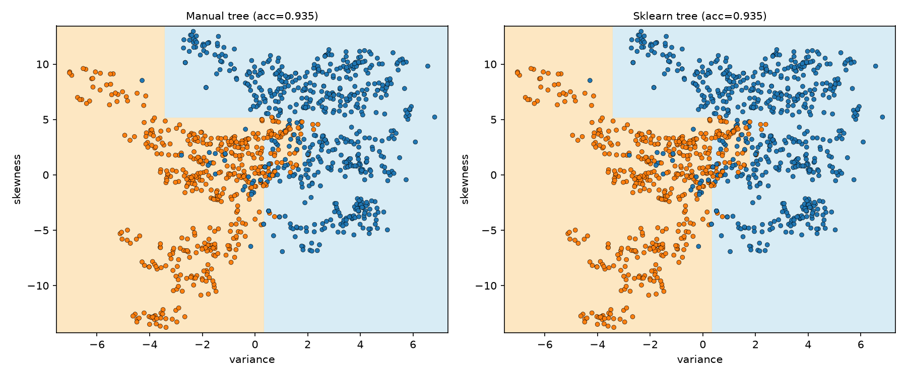
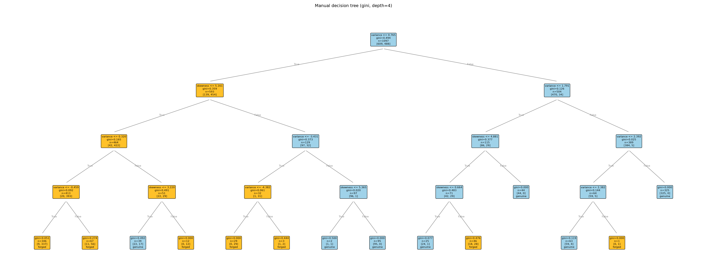
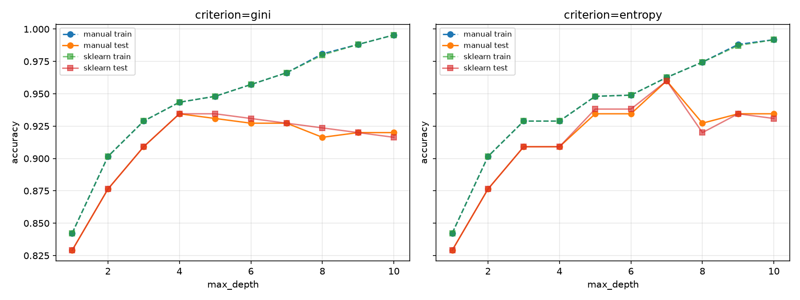
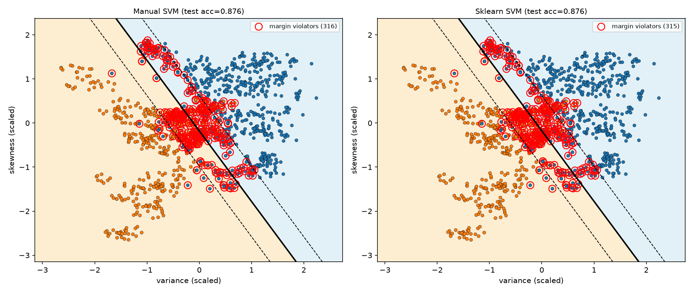
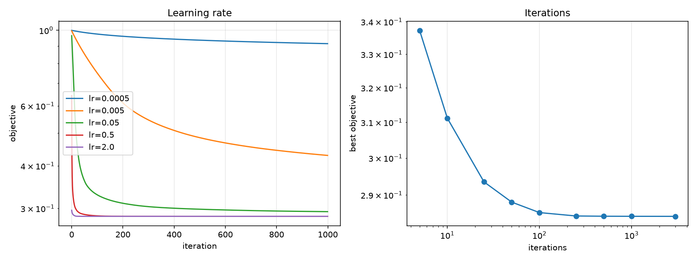
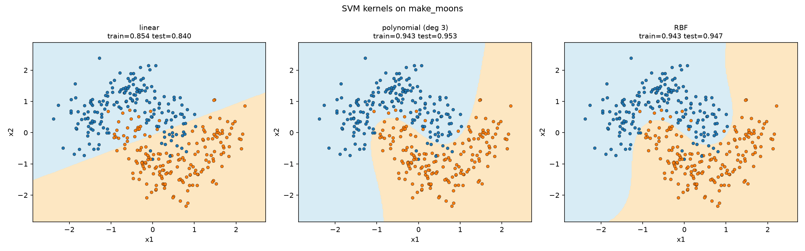
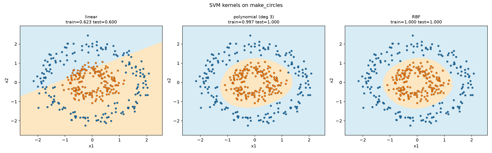
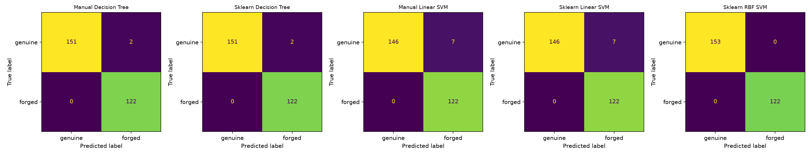
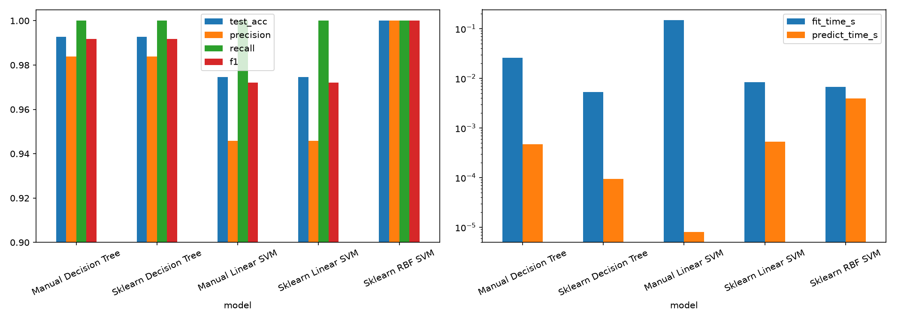
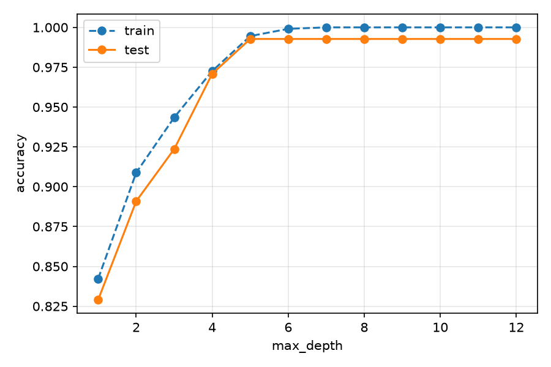

# DS605 Lab 8 - Decision Trees and Support Vector Machines

Implementation and comparison of a **Decision Tree** and a **Linear SVM written from scratch (NumPy/Pandas)** against their Scikit-learn counterparts, plus kernel SVMs on a nonlinear dataset.

**Dataset:** UCI Banknote Authentication (1,372 samples, 4 features: variance, skewness, kurtosis, entropy; class 0 = genuine, 1 = forged).

## Repository structure
```
202618005_Lab_8/
├── code.ipynb                          # all code and outputs: Parts A-D
├── data_banknote_authentication.txt    # dataset (comma-separated, no header)
├── plots/                              # decision boundaries, margin plots, manual tree, comparison charts
├── results/                            # CSV tables and the manual tree's text rules
└── README.md
```

## How to run
```bash
pip install numpy pandas scikit-learn matplotlib jupyter
jupyter notebook code.ipynb     # then Kernel -> Restart & Run All
```
The notebook reads `data_banknote_authentication.txt` from the repository root and creates `plots/` and `results/` automatically if they are missing.

## Method
- **Split:** one stratified 80/20 train/test split (`random_state=42`), reused by every Part A, B and D experiment (1,097 train / 275 test samples).
- **Features:** two features (variance, skewness) for the 2D boundary plots in Parts A and B; all four features for the final evaluation in Part D.
- **Scaling:** `StandardScaler` fitted on the training data only and applied to the test data; used for the SVMs (trees are scale-invariant).
- **From scratch (NumPy only):**
  - *Decision tree* - Gini impurity, entropy, best feature/threshold search (midpoint thresholds), recursive growth with stopping rules (`max_depth`, `min_samples_split`, `min_samples_leaf`, pure node), a `predict` function, text export of the split rules and a matplotlib drawing of the tree.
  - *Linear soft-margin SVM* - labels mapped to -1/+1; hinge loss with L2 regularisation minimised by full-batch subgradient descent. The objective is `(lam/2)||w||^2 + mean(max(0, 1 - y(w.x + b)))` with `lam = 1/(C*n)`, which has the same optimum as scikit-learn's `SVC(kernel="linear", C=C)`, so C values are directly comparable.
- **Scikit-learn** is used only for the comparison models, the split, scaling, metrics and datasets.

## Output files
| Part | Plots (`plots/`) | Tables (`results/`) |
|---|---|---|
| A | `A1_tree_boundaries.png`, `A2_manual_tree.png`, `A3_depth_curves.png`, `A4_boundaries_by_depth.png` | `A_grid.csv`, `A_manual_tree_rules.txt` |
| B | `B1_svm_margins.png`, `B2_effect_of_C.png`, `B3_lr_iterations.png` | `B_C.csv`, `B_iterations.csv` |
| C | `C_moons.png`, `C_circles.png` | `C_kernels.csv`, `C_rbf_sweep.csv` |
| D | `D1_confusion.png`, `D2_metrics_times.png`, `D3_tree_complexity.png` | `D_comparison.csv` |

---

## Part A - Decision Tree (variance, skewness)

| Manual vs scikit-learn boundaries (Gini, depth 4) | Learned manual tree |
|---|---|
|  |  |

The manual tree's split rules are in `results/A_manual_tree_rules.txt`.

**Criterion and depth exploration** (`results/A_grid.csv`; boundaries at depths 1, 4 and 10 in `plots/A4_boundaries_by_depth.png`):



**Observations**
- With Gini and `max_depth=4`, the manual tree matched scikit-learn exactly: 100% prediction agreement and 0.9345 test accuracy for both. Across all depths and both criteria, agreement stayed at 98.6% or higher; the few disagreements come from tie-breaking between equally good splits.
- With Gini, training accuracy rose steadily with depth (0.8423 at depth 1 to 0.9954 at depth 10), while test accuracy peaked at depth 4 (0.9345) and then slipped to about 0.92. Deeper trees therefore overfit, and depth 4 is the best Gini setting.
- With entropy, test accuracy peaked at depth 7 (0.9600) and fell back to 0.9345 at depth 10.
- Neither criterion is consistently better: Gini was ahead at depth 4 (0.9345 vs 0.9091), entropy at depth 7 (0.9600 vs 0.9273). The differences amount to a few test samples.
- Tree boundaries are axis-aligned rectangles that fragment into small regions as depth grows.

---

## Part B - Linear SVM (variance, skewness)



The solid line is the separating boundary, the dashed lines are the +1/-1 margins, and red rings mark margin-violating samples (shown for both models).

**Effect of C** (`results/B_C.csv`, boundaries for each C in `plots/B2_effect_of_C.png`):

| C | Manual test acc | Sklearn test acc | Manual violators | Sklearn SVs | Margin width |
|---|---|---|---|---|---|
| 0.001 | 0.8618 | 0.8618 | 910 | 912 | 3.3976 |
| 0.01 | 0.8873 | 0.8873 | 514 | 516 | 1.5965 |
| 0.1 | 0.8836 | 0.8836 | 353 | 355 | 1.0038 |
| 1 | 0.8764 | 0.8764 | 316 | 317 | 0.8472 |
| 10 | 0.8764 | 0.8764 | 311 | 311 | 0.8314 |
| 100 | 0.8764 | 0.8764 | 309 | 312 | 0.8288 |

**Learning rate and iterations** (`results/B_iterations.csv`):



**Observations**
- The manual SVM matched scikit-learn exactly in test accuracy at every C tested, and its margin-violator counts were almost identical to scikit-learn's support-vector counts (316 vs 317 at C=1).
- With only two features and a linear boundary, accuracy is limited to roughly 0.88.
- Small C gives a wider margin with more margin violators (stronger regularisation). Going from C=0.001 to C=100, margin width fell from 3.40 to 0.83 and violators from 910 to 309. Test accuracy changed little (0.862 to 0.887); one test sample is only about 0.4%.
- Learning rate: with lr=0.0005 the objective was still far from converged after 1000 iterations (0.9138), while lr of 0.5 and above reached the minimum (0.2844).
- Iterations: the objective fell from 0.337 at 5 iterations to within 1% of its final value by about 100 iterations, and was flat by 500. Test accuracy fluctuated between 0.873 and 0.887 regardless, so extra iterations improve the objective but not accuracy.

---

## Part C - Kernel SVM and nonlinear boundaries

Linear, polynomial (degree 3) and RBF kernels on `make_moons` and `make_circles` (accuracies in `results/C_kernels.csv`):

| Moons | Circles |
|---|---|
|  |  |

**Why a nonlinear kernel helps:** a linear kernel can only draw a straight line, so it cannot separate classes that are interleaved or nested. Polynomial and RBF kernels implicitly map the data into a higher-dimensional space where a linear separator exists, which appears as a curved boundary in the original 2D space.

**RBF hyperparameter sweep on moons** (`results/C_rbf_sweep.csv`; 350 train / 150 test points):

| C | gamma | Train | Test | Support vectors | Gap |
|---|---|---|---|---|---|
| 0.1 | 0.1 | 0.854 | 0.840 | 187 | 0.014 |
| 0.1 | 1 | 0.937 | 0.927 | 172 | 0.010 |
| 0.1 | 10 | 0.960 | 0.940 | 324 | 0.020 |
| 0.1 | 100 | 0.994 | 0.840 | 350 | 0.154 |
| 1 | 0.1 | 0.860 | 0.867 | 127 | -0.007 |
| **1** | **1** | **0.957** | **0.953** | **85** | **0.004** |
| 1 | 10 | 0.966 | 0.953 | 163 | 0.012 |
| 1 | 100 | 0.994 | 0.913 | 324 | 0.081 |
| 10 | 0.1 | 0.906 | 0.913 | 107 | -0.008 |
| 10 | 1 | 0.966 | 0.940 | 55 | 0.026 |
| 10 | 10 | 0.980 | 0.940 | 131 | 0.040 |
| 10 | 100 | 1.000 | 0.900 | 321 | 0.100 |
| 100 | 0.1 | 0.943 | 0.953 | 82 | -0.010 |
| 100 | 1 | 0.963 | 0.940 | 50 | 0.023 |
| 100 | 10 | 0.994 | 0.920 | 113 | 0.074 |
| 100 | 100 | 1.000 | 0.900 | 321 | 0.100 |

**Observations**
- **Underfitting** at small gamma (0.1): train and test are both low and almost equal (about 0.86), because the boundary is too smooth to follow the moon shapes.
- **Best generalisation** at moderate gamma (about 1-10) with C of 1 or more: test accuracy 0.94-0.953 with a small gap. C=1, gamma=1 is the cleanest model (0.957 train, 0.953 test, 85 support vectors). Since the moons have noise 0.25, roughly 95% looks like the ceiling.
- **Overfitting** at gamma=100: train reaches 0.994-1.000 while test drops to 0.84-0.913, and nearly every training point becomes a support vector (up to 350 of 350).
- C matters less than gamma: at gamma=10, raising C from 0.1 to 100 increased the train-test gap from 0.02 to 0.074.

---

## Part D - Final comparison (all 4 features, same split)

| Model | Train acc | Test acc | Precision | Recall | F1 | Fit time (s) | Predict time (s) |
|---|---|---|---|---|---|---|---|
| Manual Decision Tree | 0.99453 | 0.99273 | 0.98387 | 1.0 | 0.99187 | 0.02601 | 0.00047 |
| Sklearn Decision Tree | 0.99453 | 0.99273 | 0.98387 | 1.0 | 0.99187 | 0.00535 | 0.00009 |
| Manual Linear SVM | 0.98724 | 0.97455 | 0.94574 | 1.0 | 0.97211 | 0.14834 | 0.00001 |
| Sklearn Linear SVM | 0.98633 | 0.97455 | 0.94574 | 1.0 | 0.97211 | 0.00844 | 0.00053 |
| Sklearn RBF SVM | 1.00000 | 1.00000 | 1.00000 | 1.0 | 1.00000 | 0.00673 | 0.00395 |

(`results/D_comparison.csv`; times are the median of 5 runs.)

| Confusion matrices | Metrics and times |
|---|---|
|  |  |



**Observations**
- The RBF SVM performed best, with 100% test accuracy, precision, recall and F1. The decision tree followed (99.27% accuracy, F1 0.992), then the linear SVM (97.46%, F1 0.972).
- Manual and scikit-learn models gave identical test metrics for both the decision tree and the linear SVM, which confirms the from-scratch implementations.
- All models reached recall 1.0, so no forged note was missed. The remaining errors were genuine notes classified as forged: 2 for the trees, 7 for the linear SVMs and 0 for the RBF SVM.
- **Interpretability:** the tree gives readable if-then rules and the linear SVM gives one weight per feature. The RBF SVM is the hardest to interpret.
- **Scaling:** SVMs need standardised features; trees do not.
- **Overfitting:** train-test gaps are small (tree about 0.2 points, linear SVM about 1.3, RBF none). The data is nearly separable, so even simple models do well, but deeper trees overfit (`plots/D3_tree_complexity.png`), and RBF overfits at large gamma (Part C).
- **Complexity and time:** the manual SVM trains slowest (0.148 s vs 0.008 s for scikit-learn) because it runs 2000 Python-level iterations, but it predicts fastest (a single dot product). RBF predictions cost the most because each one compares against all support vectors.
- **Limitation:** all results come from a single 275-sample test set, so differences of one or two samples are not strong evidence; cross-validation would give a more reliable comparison.
